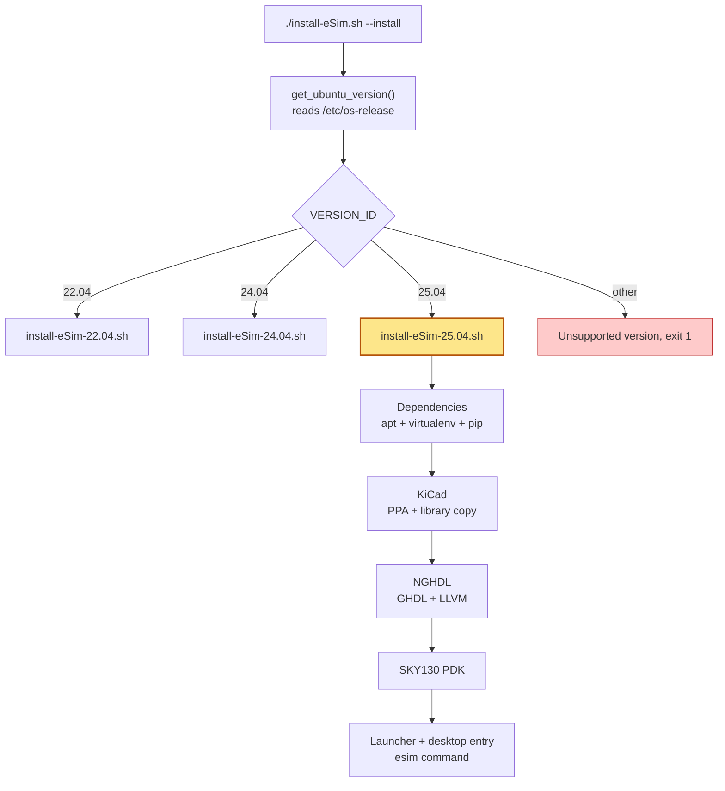
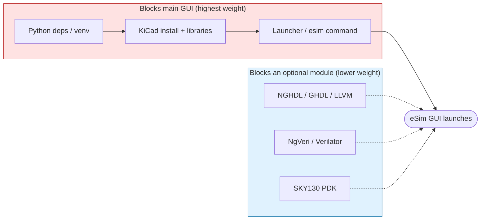
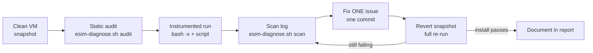

<div align="center">

# eSim 2.5 on Ubuntu 25.04
### Installer Analysis and Fixes


</div>

Submission for **FOSSEE Semester Long Internship, Autumn 2026, Task 4 (eSim Upgradation)**.

This repository documents what breaks when installing **eSim 2.5** on **Ubuntu 25.04**, why it breaks,
and the changes made to `install-eSim.sh` and its helper scripts to fix it. Every issue listed here
was reproduced from a real install log taken on a clean VM snapshot. Nothing is listed on assumption.

| | |
|---|---|
| **Author** | Gyan Prakash Patel |
| **Email** | gyan100485@gmail.com |
| **Date** | 22 November 2026 |
| **Branch** | `installer` |

---

## How the installer works

The entry script is only a dispatcher. It detects the Ubuntu version and hands over to a per-release
script, so the 25.04 script is where most problems live.



## Where failures matter most

Grading weights fixes by how much they block the main GUI. This map is how issues are ranked in this report.



> The component grouping above is a ranking guide, not a finding. Real severity for each issue is
> recorded in the issue table once it is reproduced.

## Result at a glance

> Fill this in last, from your real run. Delete this note.

| Metric | Value |
|---|---|
| Issues found | `<N>` |
| Issues fixed | `<M>` |
| Issues worked around (commented out, marked) | `<K>` |
| Issues open | `<J>` |
| Does the eSim GUI launch after install? | `<Yes / No, with details>` |

Full details are in [`docs/INSTALL_UBUNTU_25.04_REPORT.md`](docs/INSTALL_UBUNTU_25.04_REPORT.md).

---

## Issue summary

> One row per issue, ordered by impact. Issues that block the main GUI come first.

Status legend: ✅ Fixed · 🟡 Worked around · ❌ Open

| # | Component | Symptom | Blocks GUI? | Status | Commit |
|---|---|---|---|---|---|
| 1 | `<e.g. KiCad install>` | `<one line, from log>` | Yes / No | Fixed / Worked around / Open | `<hash>` |
| 2 | | | | | |

---

## Test environment

| Item | Value |
|---|---|
| Host | `<e.g. VirtualBox 7.x on Windows 11>` |
| VM | `<CPU cores, RAM, disk>` |
| OS | Ubuntu 25.04, fresh install, snapshot taken before the run |
| Kernel / Python / GCC | `<from esim-diagnose.sh env>` |
| Source | `FOSSEE/eSim`, `installer` branch, commit `<hash>` |

Raw environment capture: [`docs/env.md`](docs/env.md). Raw install logs: [`logs/`](logs/).

---

## Repository layout

```
.
├── install-eSim.sh                  # dispatcher (modified where noted in the report)
├── install-eSim-scripts/            # per-release installers; 25.04 script is the main target
├── esim-diagnose.sh                 # evidence-collection tool (see below)
├── docs/
│   ├── INSTALL_UBUNTU_25.04_REPORT.md   # full report: symptom, cause, fix, verification
│   ├── CANDIDATE_FIXES.md               # hypotheses from static reading, with status
│   ├── env.md                           # environment capture
│   └── audit.md                         # static audit output
└── logs/                            # raw install logs, one per run
```

---

## Methodology



1. **Clean state.** Fresh Ubuntu 25.04 VM, snapshot taken before anything was installed.
2. **Static audit.** `esim-diagnose.sh audit` reads the installer and checks every `apt` package name
   against the 25.04 archive, and flags PPAs, pip calls and hardcoded versions.
3. **Instrumented run.** The installer is run with `bash -x` under `script`, so every command and error
   is captured with line numbers.
4. **Signature scan.** `esim-diagnose.sh scan` matches the log against known failure patterns
   (PEP 668, missing packages, dead PPAs, compiler strictness, LLVM mismatches, removed Python modules).
5. **One fix at a time.** Each fix is a separate commit. After each, the VM is reverted to the snapshot
   and the **whole** install is re-run. A fix counts only if it works from a clean state.
6. **Disabled steps are explicit.** If a step was commented out to move past a blocker, it is marked
   `# TEMP-DISABLED (issue #N)` and listed under *Unresolved issues* in the report.

---

## The diagnostic tool

`esim-diagnose.sh` never modifies the system. It prints markdown.

```bash
bash esim-diagnose.sh env                                   # OS, Python, GCC, PEP 668, package candidates
bash esim-diagnose.sh audit install-eSim-scripts/install-eSim-25.04.sh
bash esim-diagnose.sh scan  logs/run1.log                   # match known error signatures
```

---

## Reproduce this work

```bash
# 1. Get the code
git clone -b installer https://github.com/<your-username>/eSim.git
cd eSim

# 2. Record the environment and audit the script (before running anything)
mkdir -p docs logs
bash esim-diagnose.sh env   > docs/env.md
bash esim-diagnose.sh audit install-eSim-scripts/install-eSim-25.04.sh > docs/audit.md

# 3. Run the installer with full logging
chmod +x install-eSim.sh
script -q -c "bash -x ./install-eSim.sh --install" logs/run1.log

# 4. Analyse failures
bash esim-diagnose.sh scan logs/run1.log

# 5. Launch eSim
esim
```

To test a fix: revert the VM snapshot, check out the fix commit, and repeat steps 3 to 5.

---

## Fixes

Each fix has its own commit and its own section in the report: symptom, exact error text, file and
line, root cause with evidence, diff, and the command used to verify it.

```bash
git log --oneline installer     # one commit per issue
```

---

## Known limitations

- Tested on Ubuntu 25.04 only. Behaviour on 24.04 and 26.04 was not verified.
- `<list anything still failing, and what you would try next>`

---

## Acknowledgements and references

- eSim and NGHDL: [FOSSEE, IIT Bombay](https://esim.fossee.in/)
- Upstream repository: https://github.com/FOSSEE/eSim
- `<any documentation, forum threads or man pages you actually used, with links>`

Installation problems can also be reported on the FOSSEE forum: https://forums.fossee.in/

## Licence

Same licence as upstream eSim (GPL). See `LICENSE`.
